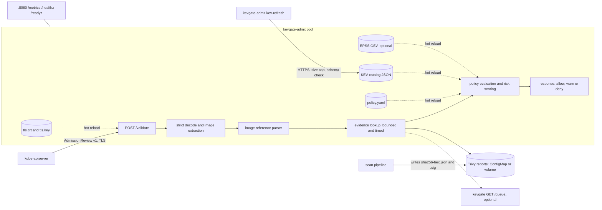

# kevgate-admit

[](https://github.com/samiali38183/kevgate-admit/actions/workflows/ci.yml)
[](https://github.com/samiali38183/kevgate-admit/actions/workflows/e2e-kind.yml)
[](https://github.com/samiali38183/kevgate-admit/actions/workflows/security.yml)

kevgate-admit is a Kubernetes validating admission webhook, written in Go. It refuses workloads whose container images carry CISA KEV-listed vulnerabilities or a risk score over a per-namespace limit. It decides from scan reports for the exact image digest, never from tags, and it does not scan images itself.

| | |
|---|---|
| Decision | allow, allow with a warning (audit mode), or deny with the findings and the rule that fired |
| Scoring | the same formula as [kevgate](https://github.com/samiali38183/kevgate). The Go version matches the Python one on 1,000 generated vectors (checked in `internal/risk`) |
| Cluster evidence | the [`e2e-kind`](.github/workflows/e2e-kind.yml) workflow installs the chart on a kind cluster and asserts allow, deny and warn outcomes. It then takes the webhook down and shows what `failurePolicy: Fail` and `Ignore` do ([transcripts](docs/E2E.md)). |
| Tests | `go test -race` in CI with an 85% coverage floor (last run 95.0%). Three fuzz targets (image references, Trivy reports, AdmissionReview decoding) run in CI for 30 s each. |
| Release | `v0.1.0` image on GHCR, signed with cosign (keyless) and attested with a CycloneDX SBOM ([verify](#published-image)). |
| Not covered | image signature verification at admission, scanning, and a multi-replica or production design. See [Limitations](#limitations). |

A deny for a Deployment in a namespace with `denyKev: true` and `maxRisk: 40`. It comes from `TestDemoScenarios`, which runs a real TLS server and feeds it AdmissionReviews built from the synthetic fixtures in `deploy/demo`:

```
kevgate-admit: request denied by policy (namespace "demo-enforce", scope "demo-enforce")
- [denyKev] registry.example.com/demo/kev-vulnerable@sha256:222222222222: 1 finding(s) in the CISA KEV catalog
    CVE-2021-44228   KEV  risk  87.5  log4j-core 2.14.1 (fixed 2.17.1)
- [maxRisk] registry.example.com/demo/kev-vulnerable@sha256:222222222222: 1 finding(s) above max risk 40.0 (highest 87.5)
    CVE-2021-44228   KEV  risk  87.5  log4j-core 2.14.1 (fixed 2.17.1)
```

All demo evidence is synthetic. The repository has no real scan data.

## What it does

For CREATE and UPDATE of Pod, Deployment, StatefulSet, DaemonSet, Job and CronJob:

1. Extract every container, init container and ephemeral container image.
2. Parse each reference strictly (OCI grammar: no dot segments, lower-case repositories, valid hosts) without ever resolving a tag. Only a digest identifies an image.
3. Look up the report for each digest: a directory or ConfigMap of `sha256-<hex>.json` files, with a kevgate HTTP API as an optional fallback. With `requireSignedEvidence`, only reports whose detached signature (`sha256-<hex>.json.sig`) verifies against a configured public key are trusted.
4. Score each finding: `risk = 100 * (0.40*kev + 0.25*acr/8 + 0.20*epss + 0.20*cvss/10) / 1.05`, rounded to one decimal.
5. Apply the namespace rule: `denyKev`, `maxRisk`, `requireDigest`, `requireEvidence`, `requireSignedEvidence`, `allowedRegistries`, exceptions with expiry, audit mode.
6. Answer with an AdmissionReview v1 response: allow, allow with warnings, or deny with a message that lists the top findings and the rule that fired.



## Quick start

```sh
go build -o bin/kevgate-admit ./cmd/kevgate-admit

# run locally with a throw-away certificate and the synthetic demo data
bin/kevgate-admit serve --self-signed --self-signed-ca-out /tmp/ca.pem \
  --policy-file deploy/demo/policy.yaml \
  --kev-file deploy/demo/kev-demo.json \
  --evidence-dir deploy/demo/reports

bin/kevgate-admit check-policy --policy-file deploy/demo/policy.yaml
bin/kevgate-admit kev-refresh --out kev.json        # downloads the real catalog over HTTPS

# sign scan reports so a policy can require authenticated evidence
bin/kevgate-admit keygen -type ed25519 -private-out report-key.pem -public-out report-key.pub.pem
cp -r deploy/demo/reports /tmp/reports
bin/kevgate-admit sign-report -key report-key.pem /tmp/reports/sha256-*.json     # writes <report>.json.sig
bin/kevgate-admit verify-report -public-key report-key.pub.pem /tmp/reports/sha256-*.json
# serve with: --evidence-dir /tmp/reports --evidence-public-key-file report-key.pub.pem, and requireSignedEvidence: true in the policy
```

To install into a cluster, use the chart (see `deploy/helm/kevgate-admit/values.yaml`). `tls.mode=helm` generates a CA and certificate for kind and demos, `tls.mode=certManager` creates a cert-manager Certificate, and `tls.mode=existingSecret` uses a Secret you provide.

## More examples

An image without a KEV finding but over the risk threshold (asset criticality 4, CVSS 9.8, EPSS 0.9) is denied in an enforcing namespace:

```
- [maxRisk] registry.example.com/demo/over-threshold@sha256:333333333333: 1 finding(s) above max risk 40.0 (highest 47.7)
    CVE-2099-10004        risk  47.7  libwidget 3.2 (fixed 3.3)
```

The same image in a namespace with `mode: audit` is admitted and returns this warning, which `kubectl` prints:

```
kevgate-admit audit: would deny [maxRisk] registry.example.com/demo/over-threshold@sha256:333333333333: 1 finding(s) above max risk 40.0 (highest 47.7)
```

## Verification

CI runs these on every push (see the badges): `go test -race` with a coverage floor, the Docker build, the kind end-to-end run (including the outage test and a `helm upgrade` check), hadolint, gosec, govulncheck, Trivy filesystem and image scans, and gitleaks. The release workflow has run once, for `v0.1.0`.

Some checks I ran only on my Windows machine with Go 1.27.4, so CI does not repeat them:

- I fuzzed the image reference parser, the Trivy parser and the AdmissionReview decoder locally with no findings. The seed corpora are in `testdata/fuzz`. They include inputs an earlier version of the parser wrongly accepted (`::0`, an invalid UTF-8 host, `ghcr.io/org/../evil`).
- I compared the image reference parser with `github.com/distribution/reference` using a differential fuzz target in a scratch module that is not in this repository. I found no input that this parser accepts and that library rejects. The reverse does happen, on purpose: the policy reference lists the deliberate differences (port range, host label length and underscores, invalid IPv6 literals, the 512 character total, digests other than sha256 and sha512, non-ASCII).
- `golangci-lint` (with gosec, errorlint, bodyclose and others) and `trivy fs` report nothing. `helm lint --strict` and `helm template | kubeconform -strict` are clean for the default values and for a values file that turns on every optional template. `zizmor --offline` is clean.

## End to end on kind

`deploy/demo/demo.sh` builds the image, creates a kind cluster and installs the chart with `tls.mode=helm` (a CA and serving certificate generated at install time) and the synthetic evidence. It applies five demo workloads and fails unless every outcome and denial text matches.

`deploy/demo/outage.sh` then scales the webhook to zero and checks what the API server does under `failurePolicy: Fail` (rejects the Pod) and `Ignore` (admits a Pod the policy would deny). It also checks that `kube-system` and the webhook namespace are never gated, and that decisions resume after recovery. `deploy/demo/upgrade.sh` runs `helm upgrade` and checks that the generated TLS Secret and the webhook `caBundle` are unchanged.

The unedited transcripts are in [docs/E2E.md](docs/E2E.md). CI does not exercise the cert-manager TLS path. `helm template | kubeconform` is its only check. The outage test does not cover `--fail-mode`, slow responses, node drains with the PodDisruptionBudget, or more than one replica.

## Published image

The `release` workflow published `v0.1.0` ([run 43080641309](https://github.com/samiali38183/kevgate-admit/actions/runs/43080641309)). It builds the image once, scans it with Trivy (HIGH and CRITICAL fail the job), pushes it, signs it with cosign (keyless, GitHub OIDC), attaches a CycloneDX SBOM attestation, and verifies both in the same run. The image is linux/amd64 only.

```text
ghcr.io/samiali38183/kevgate-admit:0.1.0
ghcr.io/samiali38183/kevgate-admit@sha256:1023382754d9b6b7ca727d47701d9e3bfb5f245a6531e0debd1307ebf9e64195
```

An anonymous pull of the manifest works (I checked against the registry API on 2026-11-13). The chart's default image (`tag` empty, so the chart `appVersion` 0.1.0) exists. To verify it:

```sh
cosign verify \
  --certificate-identity https://github.com/samiali38183/kevgate-admit/.github/workflows/release.yml@refs/tags/v0.1.0 \
  --certificate-oidc-issuer https://token.actions.githubusercontent.com \
  ghcr.io/samiali38183/kevgate-admit@sha256:1023382754d9b6b7ca727d47701d9e3bfb5f245a6531e0debd1307ebf9e64195
```

The signature shows that this workflow built and pushed the image. The webhook does not check it at admission time.

## Configuration

`kevgate-admit serve` flags:

| Flag | Default | Meaning |
| --- | --- | --- |
| `--listen` | `:8443` | TLS admission listener |
| `--metrics-listen` | `:8080` | plain HTTP for `/metrics`, `/healthz`, `/readyz` |
| `--tls-cert-file`, `--tls-key-file` | | serving pair, reloaded when the files change |
| `--self-signed`, `--self-signed-hosts`, `--self-signed-ca-out` | off | in-memory throw-away certificate for CI and development |
| `--policy-file` | | policy YAML, hot reloaded |
| `--kev-file` | | CISA KEV JSON, hot reloaded |
| `--epss-file` | | optional EPSS CSV, hot reloaded |
| `--evidence-dir` | | directory of `sha256-<hex>.json` Trivy reports |
| `--evidence-url`, `--evidence-token-file` | | optional kevgate API used when no report exists |
| `--evidence-public-key-file` | | PEM public key(s), Ed25519 or ECDSA P-256, that sign reports; enables `<report>.json.sig` verification for policies with `requireSignedEvidence` |
| `--fail-mode` | `closed` | `closed` denies when the evidence source fails, `open` allows with a warning |
| `--eval-timeout` | `8s` | budget per request; keep it below the webhook `timeoutSeconds` |
| `--lookup-timeout` | `3s` | budget per evidence lookup |
| `--max-request-bytes` | 4 MiB | request body limit |
| `--reload-interval` | `15s` | how often files are checked |

Subcommands: `serve`, `kev-refresh`, `check-policy`, `keygen`, `sign-report`, `verify-report`, `version`.

Documentation: [end to end transcripts](docs/E2E.md), [policy reference](docs/POLICY.md), [design notes](docs/DESIGN.md), [threat model](docs/THREAT_MODEL.md), [changelog](CHANGELOG.md).

## Limitations

- It does not scan images. A digest with no report is "no evidence", handled by `requireEvidence`.
- Reports go stale. `maxEvidenceAge` limits how old one can be when it has a timestamp: the signed `CreatedAt` if the report has one, otherwise the file modification time, which is not signed.
- Report signatures authenticate the report store only. The webhook does not verify image signatures or attestations (cosign, Notary). Kyverno `verifyImages` and the Sigstore policy-controller already do that, and I have not built it.
- The policy and the KEV catalog are unsigned ConfigMaps; whoever can edit them controls enforcement.
- The cert-manager TLS mode is checked with `helm template` and kubeconform only; no cluster run covers it.
- `tls.mode=helm` is for kind and demos. The CA and certificate are generated once, valid for 10 years, and never rotated. Elsewhere, use cert-manager or an existing Secret.
- Exceptions are policy entries with an expiry date, not signed attestations. Whoever can edit the policy can add one.
- A ConfigMap holds at most 1 MiB, which is a few hundred reports of typical size. Use a volume for more.

## Development

```sh
make test cover lint vet vuln helm
make fuzz            # 30 seconds per target
make race            # needs cgo
```

## License

MIT, see [LICENSE](LICENSE).
