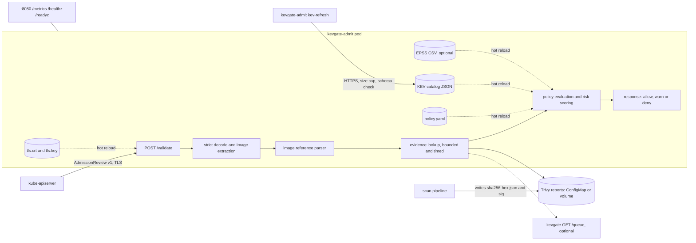

# kevgate-admit

[](https://github.com/samiali38183/kevgate-admit/actions/workflows/ci.yml)
[](https://github.com/samiali38183/kevgate-admit/actions/workflows/e2e-kind.yml)
[](https://github.com/samiali38183/kevgate-admit/actions/workflows/security.yml)

A Kubernetes validating admission webhook, written in Go, that decides whether a workload may be created based on vulnerability evidence for the exact image digests it runs. Findings are scored with the same risk model as the sibling project [kevgate](https://github.com/samiali38183/kevgate): exploitation in the wild (CISA KEV) carries the largest weight, followed by asset criticality, EPSS and CVSS.

The webhook does not scan images. It consumes reports that a scan pipeline already produced (Trivy JSON, one file per digest) and enforces a policy over them at admission time.

## What it does

For CREATE and UPDATE of Pod, Deployment, StatefulSet, DaemonSet, Job and CronJob:

1. Extract every container, init container and ephemeral container image.
2. Parse each reference strictly (OCI grammar: no dot segments, lower-case repositories, valid hosts) without ever resolving a tag. Only a digest identifies an image.
3. Look up the report for each digest (a directory or ConfigMap of `sha256-<hex>.json` files, optionally a kevgate HTTP API as a fallback). With `requireSignedEvidence`, only reports whose detached signature (`sha256-<hex>.json.sig`) verifies against a configured public key are trusted.
4. Score each finding: `risk = 100 * (0.40*kev + 0.25*acr/8 + 0.20*epss + 0.20*cvss/10) / 1.05`, rounded to one decimal.
5. Apply the namespace rule: `denyKev`, `maxRisk`, `requireDigest`, `requireEvidence`, `requireSignedEvidence`, `allowedRegistries`, exceptions with expiry, audit mode.
6. Answer with an AdmissionReview v1 response: allow, allow with warnings, or deny with a message listing the top findings and the rule that fired.



## Quick start

```sh
go build -o bin/kevgate-admit ./cmd/kevgate-admit

# run locally with a throw-away certificate and the synthetic demo data
bin/kevgate-admit serve --self-signed --self-signed-ca-out /tmp/ca.pem \
  --policy-file deploy/demo/policy.yaml \
  --kev-file deploy/demo/kev-demo.json \
  --evidence-dir deploy/demo/reports

bin/kevgate-admit check-policy --policy-file deploy/demo/policy.yaml
bin/kevgate-admit kev-refresh --out kev.json        # downloads the real catalog over HTTPS

# sign scan reports so a policy can require authenticated evidence
bin/kevgate-admit keygen -type ed25519 -private-out report-key.pem -public-out report-key.pub.pem
cp -r deploy/demo/reports /tmp/reports
bin/kevgate-admit sign-report -key report-key.pem /tmp/reports/sha256-*.json     # writes <report>.json.sig
bin/kevgate-admit verify-report -public-key report-key.pub.pem /tmp/reports/sha256-*.json
# serve with: --evidence-dir /tmp/reports --evidence-public-key-file report-key.pub.pem, and requireSignedEvidence: true in the policy
```

Install into a cluster with the chart (see `deploy/helm/kevgate-admit/values.yaml`). `tls.mode=helm` generates a CA and certificate for kind and demos, `tls.mode=certManager` creates a cert-manager Certificate, `tls.mode=existingSecret` uses a secret you provide.

## Examples from the test suite

These come from `internal/app/app_test.go` (`TestDemoScenarios`), which starts the real TLS server and posts AdmissionReviews built from the synthetic fixtures in `deploy/demo`. They are test output, not a cluster run.

A Deployment whose image carries a KEV finding, in a namespace with `denyKev: true` and `maxRisk: 40`:

```
kevgate-admit: request denied by policy (namespace "demo-enforce", scope "demo-enforce")
- [denyKev] registry.example.com/demo/kev-vulnerable@sha256:222222222222: 1 finding(s) in the CISA KEV catalog
    CVE-2021-44228   KEV  risk  87.5  log4j-core 2.14.1 (fixed 2.17.1)
- [maxRisk] registry.example.com/demo/kev-vulnerable@sha256:222222222222: 1 finding(s) above max risk 40.0 (highest 87.5)
    CVE-2021-44228   KEV  risk  87.5  log4j-core 2.14.1 (fixed 2.17.1)
```

An image without a KEV finding but over the risk threshold (asset criticality 4, CVSS 9.8, EPSS 0.9):

```
kevgate-admit: request denied by policy (namespace "demo-enforce", scope "demo-enforce")
- [maxRisk] registry.example.com/demo/over-threshold@sha256:333333333333: 1 finding(s) above max risk 40.0 (highest 47.7)
    CVE-2099-10004        risk  47.7  libwidget 3.2 (fixed 3.3)
```

The same image in a namespace with `mode: audit` is admitted and returns this warning, which `kubectl` prints:

```
kevgate-admit audit: would deny [maxRisk] registry.example.com/demo/over-threshold@sha256:333333333333: 1 finding(s) above max risk 40.0 (highest 47.7)
```

## Verification status

Measured on a Windows workstation with Go 1.27.4:

- 93 top-level tests (482 including subtests and fuzz seed runs), total statement coverage 95.0 percent across all packages.
- The scoring function matches the Python kevgate implementation on 1000 vectors generated by `scripts/gen_parity.py` (a grid plus a seeded random sample), alongside 12 hand-computed vectors.
- Three fuzz targets, each run for 60 seconds locally with no findings: `FuzzParse` for image references (17,574,522 executions), `FuzzParse` for the Trivy parser (3,552,242) and `FuzzDecodeAndExtract` for the AdmissionReview decoder (1,758,884). Seed corpora are in `testdata/fuzz`; the reference corpus includes the inputs that the earlier parser wrongly accepted (`::0`, an invalid UTF-8 host, `ghcr.io/org/../evil`).
- The image reference parser was also compared against `github.com/distribution/reference` with a differential fuzz target in a scratch module (not part of this repository): a 120 second run of 14,907,530 executions found no case where this parser accepts something that library rejects, and the only inputs it rejects that the library accepts are the deliberate differences listed in the policy reference (port range, host label length and underscores, invalid IPv6 literals, the 512 character total, non-sha256/512 digests, non-ASCII).
- `go vet`, `golangci-lint` (with gosec, errorlint, bodyclose and others), `govulncheck` and `trivy fs` report nothing.
- `helm lint --strict` and `helm template | kubeconform -strict` are clean for the default values and for a values file that enables every optional template (cert-manager Certificate and ServiceMonitor schemas from the datree CRDs catalog).
- `actionlint`, `shellcheck` and `zizmor --offline` are clean.
- The race detector needs cgo and a C compiler, which this workstation does not have, so `go test -race` has not been run locally. CI runs it.

Verified by CI on GitHub Actions (see the badges above): the Docker build, the kind end to end run including the outage test, hadolint, gosec, govulncheck, the Trivy filesystem and image scans, gitleaks, and `go test -race`.

## End to end transcript

`deploy/demo/demo.sh` runs in the `e2e-kind` workflow on a hosted runner: it builds the image, creates a kind cluster, loads the image, installs the chart with `tls.mode=helm` (a CA and serving certificate generated at install time) and the synthetic evidence from `deploy/demo/reports`, then applies the demo workloads and fails the job unless every outcome and denial text matches. The webhook log, pod descriptions, resource listing, metrics and this transcript are uploaded as the `e2e-demo-output` artifact. The cert-manager path is not exercised in CI; it is only covered by `helm template | kubeconform`.

Below is the unedited output of that step from a passing run (timestamps trimmed). The "waiting" step sends one or more extra requests for the always-denied `tag-only` workload until the webhook answers, so they are also counted in the decision counters. The counters also include the Pods that the Deployments in `clean` and `over-threshold-audit` create.

```text
== namespaces and evidence
namespace/kevgate-system created
namespace/demo-enforce created
namespace/demo-audit created
configmap/demo-kev created
configmap/demo-evidence created

== installing the chart
Release "kevgate-admit" does not exist. Installing it now.
NAME: kevgate-admit
LAST DEPLOYED: Wed Nov 11 04:17:00 2026
NAMESPACE: kevgate-system
STATUS: deployed
REVISION: 1
DESCRIPTION: Install complete
TEST SUITE: None

== waiting for the webhook endpoint to accept connections

== clean in demo-enforce (expect: allowed)
deployment.apps/clean created
RESULT clean: PASS

== kev-vulnerable in demo-enforce (expect: denied)
Error from server (Forbidden): error when creating "/home/runner/work/kevgate-admit/kevgate-admit/deploy/demo/workloads/kev-vulnerable.yaml": admission webhook "validate.kevgate-admit.samiali38183.github.io" denied the request: kevgate-admit: request denied by policy (namespace "demo-enforce", scope "demo-enforce")
- [denyKev] registry.example.com/demo/kev-vulnerable@sha256:222222222222: 1 finding(s) in the CISA KEV catalog
    CVE-2021-44228   KEV  risk  87.5  log4j-core 2.14.1 (fixed 2.17.1)
- [maxRisk] registry.example.com/demo/kev-vulnerable@sha256:222222222222: 1 finding(s) above max risk 40.0 (highest 87.5)
    CVE-2021-44228   KEV  risk  87.5  log4j-core 2.14.1 (fixed 2.17.1)
RESULT kev-vulnerable: PASS

== over-threshold-enforce in demo-enforce (expect: denied)
Error from server (Forbidden): error when creating "/home/runner/work/kevgate-admit/kevgate-admit/deploy/demo/workloads/over-threshold.yaml": admission webhook "validate.kevgate-admit.samiali38183.github.io" denied the request: kevgate-admit: request denied by policy (namespace "demo-enforce", scope "demo-enforce")
- [maxRisk] registry.example.com/demo/over-threshold@sha256:333333333333: 1 finding(s) above max risk 40.0 (highest 47.7)
    CVE-2099-10004        risk  47.7  libwidget 3.2 (fixed 3.3)
RESULT over-threshold-enforce: PASS

== over-threshold-audit in demo-audit (expect: warned)
Warning: kevgate-admit audit: would deny [maxRisk] registry.example.com/demo/over-threshold@sha256:333333333333: 1 finding(s) above max risk 40.0 (highest 47.7)
deployment.apps/over-threshold created
RESULT over-threshold-audit: PASS

== tag-only in demo-enforce (expect: denied)
Error from server (Forbidden): error when creating "/home/runner/work/kevgate-admit/kevgate-admit/deploy/demo/workloads/tag-only.yaml": admission webhook "validate.kevgate-admit.samiali38183.github.io" denied the request: kevgate-admit: request denied by policy (namespace "demo-enforce", scope "demo-enforce")
- [requireDigest] registry.example.com/demo/clean:latest: image is not pinned by digest; tags are mutable
RESULT tag-only: PASS

== collecting webhook logs and metrics
kevgate_admit_decisions_total{namespace="demo-audit",outcome="audit_deny",rule="maxRisk"} 2
kevgate_admit_decisions_total{namespace="demo-enforce",outcome="allow",rule="none"} 2
kevgate_admit_decisions_total{namespace="demo-enforce",outcome="deny",rule="denyKev"} 1
kevgate_admit_decisions_total{namespace="demo-enforce",outcome="deny",rule="maxRisk"} 1
kevgate_admit_decisions_total{namespace="demo-enforce",outcome="deny",rule="requireDigest"} 2

demo finished: all checks passed
```


### Failure modes: webhook down, then recovery

The same workflow then runs `deploy/demo/outage.sh` against the same cluster. It checks that `kube-system` and the webhook namespace are not gated, scales the webhook to zero replicas, shows what the API server does under `failurePolicy: Fail` and under `Ignore`, restores the webhook and checks that allow and deny decisions resume. The script fails the job unless every assertion holds. With zero endpoints the API server's error text says "failed calling webhook", which the script asserts; the exact reason after it (here `connection refused`) depends on the Kubernetes version and kube-proxy.

What this shows, and what it does not:

- Under `Fail` a Pod create is rejected while the webhook is down, and nothing is created. The excluded namespaces (`kube-system`, the webhook's namespace) keep admitting, which is what lets the webhook come back.
- Under `Ignore` the same outage admits a Pod that the policy denies (a tag-only image in an enforcing namespace). That is the bypass window of that setting.
- It does not test `--fail-mode` (the webhook answering but unable to judge), slow responses or timeouts at the API server, node drains with the PodDisruptionBudget, or `helm upgrade`. The demo runs one replica.

Unedited output of that step from a passing run (timestamps trimmed; run <https://github.com/samiali38183/kevgate-admit/actions/runs/43042286763>):

```text
== webhook configuration under test
failurePolicy: Fail, replicas: 1
namespaceSelector: kubernetes.io/metadata.name NotIn ["kube-system","kube-public","kube-node-lease","kevgate-system"]

== baseline: a tag-only Pod is denied in a gated namespace
Error from server (Forbidden): error when creating "STDIN": admission webhook "validate.kevgate-admit.samiali38183.github.io" denied the request: kevgate-admit: request denied by policy (namespace "demo-enforce", scope "demo-enforce")
- [requireDigest] registry.example.com/demo/clean:latest: image is not pinned by digest; tags are mutable
RESULT baseline-denied: PASS

== self-exclusion: the same Pod is not judged in kube-system or in the webhook namespace
pod/excluded-kube-system created (server dry run)
RESULT excluded-kube-system: PASS
pod/excluded-kevgate-system created (server dry run)
RESULT excluded-kevgate-system: PASS

== outage: scale the webhook to zero replicas
deployment.apps/kevgate-admit scaled
pod/kevgate-admit-76778bfc5-6p2cr condition met
Warning: v1 Endpoints is deprecated in v1.33+; use discovery.k8s.io/v1 EndpointSlice
NAME                      ENDPOINTS   AGE
endpoints/kevgate-admit   <none>      5s

== failurePolicy Fail: a Pod create is rejected by the API server
Error from server (InternalError): error when creating "STDIN": Internal error occurred: failed calling webhook "validate.kevgate-admit.samiali38183.github.io": failed to call webhook: Post "https://kevgate-admit.kevgate-system.svc:443/validate?timeout=10s": dial tcp 10.96.183.14:443: connect: connection refused
RESULT fail-policy-rejects: PASS
RESULT fail-policy-no-pod: PASS

== failurePolicy Fail: excluded namespaces still admit during the outage
pod/excluded-kube-system created (server dry run)
RESULT outage-excluded-kube-system: PASS
pod/excluded-kevgate-system created (server dry run)
RESULT outage-excluded-kevgate-system: PASS

== failurePolicy Ignore: the same outage admits the Pod, even one the policy would deny
validatingwebhookconfiguration.admissionregistration.k8s.io/kevgate-admit patched
pod/outage-ignore created
RESULT ignore-policy-admits-tag-only-pod: PASS
pod "outage-ignore" deleted from demo-enforce namespace

== restore: failurePolicy back to Fail, webhook back to 1 replicas
validatingwebhookconfiguration.admissionregistration.k8s.io/kevgate-admit patched
deployment.apps/kevgate-admit scaled
Waiting for deployment "kevgate-admit" rollout to finish: 0 of 1 updated replicas are available...
deployment "kevgate-admit" successfully rolled out
RESULT webhook-answers-again: PASS

== normal decisions resume: denied
Error from server (Forbidden): error when creating "STDIN": admission webhook "validate.kevgate-admit.samiali38183.github.io" denied the request: kevgate-admit: request denied by policy (namespace "demo-enforce", scope "demo-enforce")
- [requireDigest] registry.example.com/demo/clean:latest: image is not pinned by digest; tags are mutable
RESULT resumed-deny-tag-only: PASS
Error from server (Forbidden): error when creating "/home/runner/work/kevgate-admit/kevgate-admit/deploy/demo/workloads/kev-vulnerable.yaml": admission webhook "validate.kevgate-admit.samiali38183.github.io" denied the request: kevgate-admit: request denied by policy (namespace "demo-enforce", scope "demo-enforce")
- [denyKev] registry.example.com/demo/kev-vulnerable@sha256:222222222222: 1 finding(s) in the CISA KEV catalog
    CVE-2021-44228   KEV  risk  87.5  log4j-core 2.14.1 (fixed 2.17.1)
- [maxRisk] registry.example.com/demo/kev-vulnerable@sha256:222222222222: 1 finding(s) above max risk 40.0 (highest 87.5)
    CVE-2021-44228   KEV  risk  87.5  log4j-core 2.14.1 (fixed 2.17.1)
RESULT resumed-deny-kev: PASS

== normal decisions resume: allowed
pod/outage-clean created
RESULT resumed-allow-clean: PASS

outage test finished: all checks passed
```

## Configuration

`kevgate-admit serve` flags:

| Flag | Default | Meaning |
| --- | --- | --- |
| `--listen` | `:8443` | TLS admission listener |
| `--metrics-listen` | `:8080` | plain HTTP for `/metrics`, `/healthz`, `/readyz` |
| `--tls-cert-file`, `--tls-key-file` | | serving pair, reloaded when the files change |
| `--self-signed`, `--self-signed-hosts`, `--self-signed-ca-out` | off | in-memory throw-away certificate for CI and development |
| `--policy-file` | | policy YAML, hot reloaded |
| `--kev-file` | | CISA KEV JSON, hot reloaded |
| `--epss-file` | | optional EPSS CSV, hot reloaded |
| `--evidence-dir` | | directory of `sha256-<hex>.json` Trivy reports |
| `--evidence-url`, `--evidence-token-file` | | optional kevgate API used when no report exists |
| `--evidence-public-key-file` | | PEM public key(s), Ed25519 or ECDSA P-256, that sign reports; enables `<report>.json.sig` verification for policies with `requireSignedEvidence` |
| `--fail-mode` | `closed` | `closed` denies when the evidence source fails, `open` allows with a warning |
| `--eval-timeout` | `8s` | budget per request; keep it below the webhook `timeoutSeconds` |
| `--lookup-timeout` | `3s` | budget per evidence lookup |
| `--max-request-bytes` | 4 MiB | request body limit |
| `--reload-interval` | `15s` | how often files are checked |

Subcommands: `serve`, `kev-refresh`, `check-policy`, `keygen`, `sign-report`, `verify-report`, `version`.

Documentation: [policy reference](docs/POLICY.md), [design notes](docs/DESIGN.md), [threat model](docs/THREAT_MODEL.md), [changelog](CHANGELOG.md).

## Limitations

- It does not scan images. A digest with no report is "no evidence", handled by `requireEvidence`.
- Reports go stale. `maxEvidenceAge` bounds it when the report carries a timestamp (a signed one when the report has `CreatedAt`; otherwise the unsigned file modification time).
- Report signatures authenticate the report store only. There is no image signature or attestation verification (cosign, Notary); that is future work, and Kyverno `verifyImages` or the Sigstore policy-controller already do it.
- The policy and the KEV catalog are unsigned ConfigMaps; whoever can edit them controls enforcement.
- The cert-manager TLS mode is checked with `helm template` and kubeconform only; no cluster run covers it.
- The chart in `tls.mode=helm` was not tested across `helm upgrade` and may remove its generated Secret; use cert-manager or an existing Secret outside demos.
- Exceptions are policy entries with an expiry date, not signed attestations. Whoever can edit the policy can add one.
- ConfigMaps are limited to 1 MiB in total, which is a few hundred typical reports. Use a volume for more.

## Development

```sh
make test cover lint vet vuln helm
make fuzz            # 30 seconds per target
make race            # needs cgo
```

## License

MIT, see [LICENSE](LICENSE).
